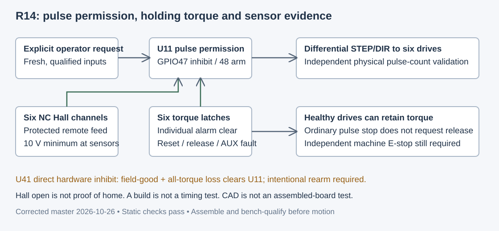
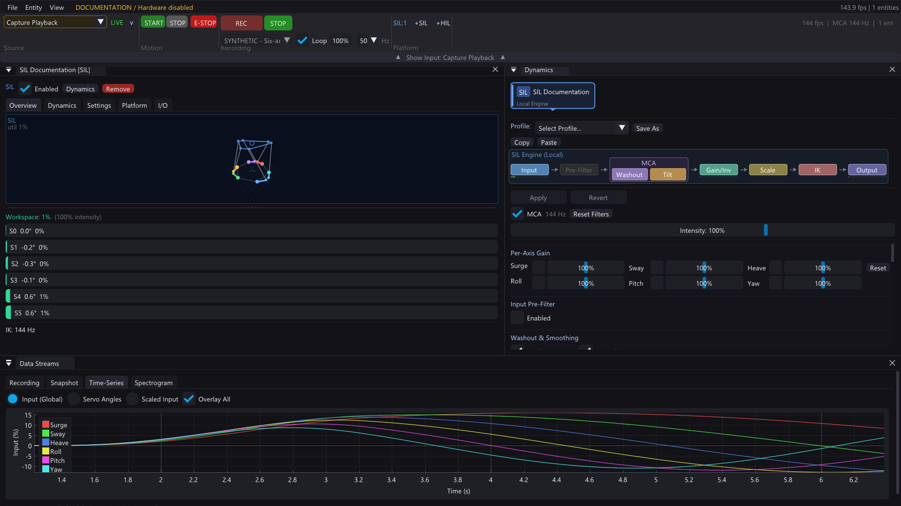

# 6DOF Rotary Stewart Motion Simulator

A DIY, open-source motion simulator built around a **six-axis rotary Stewart
platform**: six servo-driven arms and connecting rods move a platform in surge,
sway, heave, roll, pitch and yaw. The project brings together the mechanical
build, custom electronics, ESP32 controller firmware and a desktop app for
simulation, motion cueing and testing.

It began as a full-size racing-simulator build and has grown into a development
platform of its own, including a smaller hobby-servo version. This repository
shares the build history and videos as well as the code, design files and lessons
learned along the way—not just the latest PCB package.

[Watch the videos](#demo-and-build-videos) · [Project history](#a-bit-of-project-history) ·
[Desktop app](#desktop-app) · [Get started](#getting-started) · [Support the project](#support-the-project)

  

## Current development status

> **2026-10-27: R14 engineering hold following a JLCPCB component-clearance query.**
> The ordered placement has confirmed J12 interference. J12 remains required;
> R14C1 now passes the documented internal mechanical and exported electrical checks.
> Complete replacement files are prepared; factory acceptance and physical tests remain pending.
> See the [mechanical correction](hardware/pcb/6dof2_r14/MECHANICAL_CORRECTION.md).
> The recovered R13 firmware baseline and original ordered exports are preserved.
> See the [R14 board, schematic and status](hardware/pcb/6dof2_r14/README.md),
> [design philosophy](hardware/pcb/6dof2_r14/DESIGN_PHILOSOPHY.md) and
> [firmware evidence](hardware/pcb/6dof2_r14/FIRMWARE_STATUS.md).

Heavy rotating machinery can cause serious injury or death. Independent emergency
stop hardware must be in place before powered operation; the app's E-STOP button
is not a substitute for a physical safety system. Earlier working builds and
signal captures do **not** validate the current PCB/firmware combination.

## R14C1 corrected hardware

[PCB PDF](hardware/pcb/6dof2_r14/drawings/R14C1-PCB.pdf) ·
[Schematic PDF](hardware/pcb/6dof2_r14/drawings/R14-schematic.pdf) ·
[Native schematic SVG](hardware/pcb/6dof2_r14/exports/2026-10-27-clearance/R14-schematic.svg) ·
[Editable EasyEDA project](hardware/pcb/6dof2_r14/exports/2026-10-27-clearance/R14-project.epro2) ·
[Manufacturing files](hardware/pcb/6dof2_r14/exports/2026-10-27-clearance/README.md)

The owner confirmed the R14 order on 26 October 2026. Read the
[design decisions](hardware/pcb/6dof2_r14/DECISIONS.md),
[review methodology](hardware/pcb/6dof2_r14/REVIEW_METHOD.md) and
[hardware-test plan](hardware/pcb/6dof2_r14/BRINGUP.md). Testing the manufactured
board follows correction of the factory clearance issue; the current firmware
keeps normal motion admission locked.

R14 schematic preview — full sheet and detail pages in the PDF

These are crops of the native schematic, retaining named-net stubs and source
label placement. Use the linked vector PDF/SVG to inspect the complete sheet.

## Demo and build videos

Watch the original platform demonstrations and controller build videos below.
Click a thumbnail to open YouTube. These document earlier builds, not an assembled
or tested r13 board.

### Platform demonstrations

  
  

[Platform demo 1](https://www.youtube.com/watch?v=_NR_MUGvmUo) ·
[Platform demo 2](https://www.youtube.com/watch?v=CdDkL8X6qOE)

### Controller PCB build videos

  
  

[PCB video — part 1](https://www.youtube.com/watch?v=fEcdGIq_Jzc) ·
[PCB video — part 2](https://www.youtube.com/watch?v=1WXx59tWYc4)

## A bit of project history

**2020–2021 — the original rig.** The repository started in January 2020 around
a full-size rotary Stewart platform, six AC servos and an ESP32 controller taking
SimTools input. Development included custom controller and magnetic-sensor PCBs,
dual-core Arduino firmware, MCP23S17 I/O expansion, Android BLE controls and a
.NET platform tester. The build and demo videos above come from this early period.

**2025 — the “Phoenix” modernization.** Work resumed with Python visualization,
an ESP32-S3 migration and, later that year, a move from Arduino to ESP-IDF. The
controller and its development tools evolved alongside the mechanical project.

**2026 — a shared simulation and hardware workbench.** A native C++ desktop app
arrived in February, bringing 3D visualization, motion cueing, recording and
software/hardware-in-the-loop workflows together. In July, the shared math was
extracted into `stewart-core`, and the desktop-scale Mini-6DOF hobby-servo firmware
joined this repository. October work includes manufactured R13 single-axis bench testing, recovery of the
exact tested firmware, and R14 power, torque-latch and Hall-interface review. The
hardware/controller/app split and illustrated app documentation remain separate
from physical hardware qualification.

The project has evolved through several hardware and software generations. Old
videos, timing measurements and design files are preserved as history; use the
[current R14 status](hardware/pcb/6dof2_r14/README.md) and
[firmware evidence](hardware/pcb/6dof2_r14/FIRMWARE_STATUS.md) for today's implementation
and testing requirements.

## The hardware behind the project

The original full-size build described in this repository uses:

- A **31-inch-diameter, ½-inch steel base plate**.
- **Six 750 W AC servo motors**, 50:1 planetary gearboxes and couplers.
- **AASD-15A servo drives** with step/direction signaling.
- Twelve ½-inch Panhard bar kits with rod ends and high-misalignment spacers for the linkage.

These describe the original build, not a complete shopping list or a claim that
all historical controller revisions are interchangeable.

The newer **“6DOF 2” controller** is an ESP32-S3 PCB design with W5500 Ethernet,
six matching DB25 servo connectors, differential STEP/DIR outputs, conditioned
alarm inputs and a supervised stop/inhibit circuit. R13 has one-axis bench evidence. R14 adds independent torque latches, protected
remote Hall power and additional monitoring; its new circuits and six-axis
firmware still need physical qualification.

The [Mini-6DOF variant](controller/mini/README.md) uses an ESP32 and six hobby
servos for desktop-scale development. Mechanical assets live under
[hardware/mechanical/](hardware/mechanical/); the
[geometry guide](hardware/mechanical/platform_geometry.md) explains platform
dimensions and calibration.

## Desktop app

  
   <em>Actual app screenshot using synthetic SIL data in hardware-disabled documentation mode—not r13 hardware telemetry.</em>

The native C++/OpenGL/ImGui app is both a simulator and a development workbench:

- **3D platform views** with servo-angle readouts and editable geometry.
- **Independent entities** for software-in-the-loop (SIL) experiments and hardware-in-the-loop (HIL) development.
- **Motion cueing and filtering** with per-axis controls and frequency-response views.
- **Input plugins** for Assetto Corsa, SimTools, manual controls and test signals.
- **Recording and playback**, time-series plots, spectrograms and diagnostic logs.
- **Shared math** for inverse kinematics, axis scaling and motion cueing, used by the desktop app and controller firmware.
- **MCP automation** for repeatable UI setup and genuine app screenshots, including an isolated mode that blocks hardware access.

Start with the [illustrated app guide](docs/APP_GUIDE.md). The
[app README](app/README.md) contains deeper technical detail, and
[app automation](docs/APP_AUTOMATION.md) explains the MCP interface and its
current coverage. Software tests and synthetic demonstrations are not physical
hardware acceptance tests.

## Getting started

1. **Explore the software:** follow the [build guide](docs/BUILD.md), then use the
   [app guide](docs/APP_GUIDE.md). For an explicitly hardware-disabled session,
   use the [documentation-mode workflow](docs/APP_AUTOMATION.md).
2. **Choose the right controller:** read the [firmware variant map](docs/FIRMWARE.md)
   before working with the full-size, Mini or analyzer firmware. Their outputs
   and hardware requirements differ.
3. **Review the PCB:** use the [R14 overview](hardware/pcb/6dof2_r14/README.md),
   [review evidence](hardware/pcb/6dof2_r14/review/README.md),
   and [bench qualification plan](hardware/pcb/6dof2_r14/BRINGUP.md).
   Buying and bench-use guidance is indexed in [Hardware](hardware/README.md);
   the current **do-not-order** status still applies.

## Repository layout

| Start here | Contents |
| --- | --- |
| [Hardware](hardware/README.md) | `hardware/pcb/` design packages, buying/bench-use guides and `hardware/mechanical/` models |
| [Controller](controller/README.md) | Full-size firmware, Mini firmware, shared math, diagnostics and tests |
| [App](app/README.md) | Native desktop simulator/control app, MCP tools and optional Linux HIL bridge |
| [Documentation](docs/README.md) | Build instructions, illustrated app usage, firmware, architecture and automation references |

For source paths, submodule setup and build directories, see the
[build guide](docs/BUILD.md#repository-layout).

## Support the project

If you enjoy the project or find the code, designs and build videos useful,
you can support its continued development: **[Donate via PayPal](https://www.paypal.me/knaufinator)**.

Bug reports, documentation corrections and reproducible test results are welcome
too. When reporting hardware behavior, include the board revision and firmware
version so results from different generations do not get mixed together.

## License

MIT — see [LICENSE](LICENSE). Use at your own risk.
