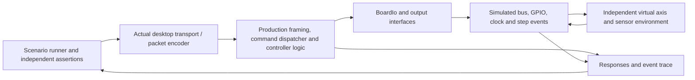

# Firmware simulation and integration-test plan

**Proposed, 28 October 2026. Implementation has not started.** Baseline: `b99b3a2`, PR #32, ESP-IDF 5.5.2, shared core `118e6b0965cee674994bd66d7b9fb7f07c7420e8`. This plan adds runtime integration evidence while preserving the recovered R13 engine and the current R14 motion lock.

## Current coverage and the missing layer

CI already builds full-size and Mini firmware, runs 85 controller C++ tests on Linux/Windows, exercises 9 source-contract and 10 bench-host tests, and runs the Windows app's two CTest checks. The engineering workflow checks artifacts, links, outlines, body/access clearances and all 324 STEP models. Some unit tests already simulate register values, elapsed time and admission states.

CI does **not** currently boot an ESP32 emulator, run the firmware command dispatcher through a simulated board, or connect the actual desktop transport implementation to a running simulated controller. Desktop SIL exercises math and presentation; it is not an emulated controller. The separate `controller/test_harness` image is a physical analyzer, not a firmware emulator.

One important implementation limit must remain visible: `MotionAdmission<false>` is the production staging type, and `normal_motion_permitted()` currently returns false even for the test-qualified specialization. Passing a simulated home sequence must not be described as working production R14 homing or permission for normal six-axis motion.

## Recommended architecture

Build two complementary software lanes: deterministic host integration first, then ESP32-S3 QEMU boot/protocol tests. Keep physical pulse and board qualification separate.

The host lane compiles reusable production logic for the host; it does not emulate Xtensa instructions. The QEMU lane executes an ESP32-S3 image and FreeRTOS using the peripherals actually supported by the pinned emulator. Both must identify substituted drivers explicitly.

| Layer | Intended evidence | Limit |
| --- | --- | --- |
| Existing unit tests | Pure math, interlocks, decoded inputs and pulse-schedule rules | Does not exercise all runtime wiring |
| Deterministic host integration | Real protocol/dispatch → state → bus/output actions → telemetry under injected faults | Virtual time and scheduling, not target interrupt timing |
| QEMU integration | Target boot, task startup, command/response, persistence and reset behavior for supported paths | Missing peripherals require explicit adapters; no assumed board equivalence |
| Physical fixture | Actual MCPWM edges, independent inhibit, differential interfaces and external devices | Requires identified boards and independent measurements |

## Emulator choice and feasibility gate

Espressif documents ESP32-S3 support in its QEMU fork and `idf.py qemu` integration. Start with that supported toolchain route and pin the emulator version; do not upgrade ESP-IDF just to introduce simulation. [ESP-IDF 5.5.2 QEMU guide](https://docs.espressif.com/projects/esp-idf/en/v5.5.2/esp32s3/api-guides/tools/qemu.html).

The first experiment must attempt the **unmodified current R14 image** in an isolated emulator, record the first unsupported access/startup failure, and build a support inventory for MCPWM register behavior, native USB Serial/JTAG, W5500 SPI/interrupts, I²C, GPIO and timers. Support for an ESP32-S3 CPU does not establish support for those exact paths. A boot failure caused by an absent emulator peripheral is a coverage finding, not immediately a firmware defect.

If adaptation is necessary, create a separately named simulation build using the same application logic and narrow hardware adapters. Preserve `R14_FAIL_CLOSED=ON`; never replace a failed device with an always-healthy stub. Capture every excluded peripheral, configuration change and image hash. A changed console, network driver or output backend means a different artifact and a narrower claim than running the production binary.

QEMU documents an OpenCores Ethernet interface. Using that adapter can exercise network/protocol behavior but cannot qualify the board's W5500 driver, SPI signaling or interrupt behavior. [Espressif ESP32-S3 emulator notes](https://github.com/espressif/esp-toolchain-docs/blob/main/qemu/esp32s3/README.md).

Wokwi supports ESP32-S3 and automated CI scenarios, but its current peripheral table marks MCPWM unsupported. It is optional for interactive sensor/protocol experiments, not the primary proof of this pulse engine. Its CI also has a cloud service/account dependency. [Peripheral support](https://docs.wokwi.com/guides/esp32), [CI architecture](https://docs.wokwi.com/wokwi-ci/getting-started).

ESP-IDF's Linux/POSIX target is another possible adapter route, but it is experimental, has limited component coverage and single-core scheduling. Use it only if the feasibility spike establishes a concrete benefit over a small deterministic host runner. [ESP-IDF host execution](https://docs.espressif.com/projects/esp-idf/en/v5.5.2/esp32s3/api-guides/host-apps.html).

## Implementation sequence

### 1. Freeze contracts and establish the emulator support map

- Record the baseline commit, submodule, build options, image hashes and retained R13 source/binary provenance. Preserve the existing R13 bench-only CI/release build prohibition.
- Inventory startup calls and dependencies in `main.cpp`, `CobsTransport.cpp`, `EthernetTransport.cpp`, `R14Hardware.cpp` and `SharedMcpwmStepEngine.h`.
- Define trace events at input sampling, command dispatch, admission decision, output write, simulated step emission and reset. Give every event a virtual timestamp and scenario ID.
- Attempt the production-image QEMU boot and document supported, substituted and untested peripherals. Do not silently omit boot initialization to obtain a passing result.

**Exit:** a checked-in support matrix, reproducible boot attempt/log, and narrow proposed code seams. No production behavioral change or new claim of emulated pulse timing.

### 2. Add a deterministic controller integration runner

- Reuse `r14::RegisterBus`, `BoardIo`, admission/seek/alarm logic, quiescence and the actual COBS/command handling code. Extract only the application seams needed for host compilation; do not write a second controller in Python.
- Inject monotonic time, board inputs, bus transactions, output operations and transport endpoints. Preserve production bindings to ESP-IDF. Prove unchanged production builds and existing tests after each extraction.
- Model the subset of MCP23017 and INA226 behavior actually used: warm retained latches/bank state, register widths and readback, device IDs, conversion readiness, bus voltage and read/write failures. Match current pin polarities and the schematic. The INA226 represents voltage here, not current sensing.
- Separate input faults from bus faults. In particular, drive-alarm injection must remain observable while I²C operations fail or stall within their modeled timeout.
- Produce structured results and replayable traces. Use virtual-time deadlines derived from configured polling, debounce and timeout behavior; do not assert invented physical response times.

**Exit:** end-to-end scenarios reach the production dispatcher and verify observable outputs, with a deterministic replay command and no hardware I/O. Pure helper tests alone do not satisfy this milestone.

### 3. Connect the real desktop transport and virtual environment

- Add a headless integration executable that uses the production packet encoders and applicable `UdpTransport` control/telemetry paths. Exercise direct-controller mode and bridge mode separately; do not assume they have the same handshake.
- Bind only isolated test endpoints. Use temporary settings/NVS/recordings and explicit endpoint configuration; never discover serial ports, broadcast to the LAN or use live device addresses.
- Keep documentation mode's transport protections intact. It intentionally blocks network/HIL operations and is not the route for these integration tests.
- Drive a virtual axis/environment from **simulated emitted step events**, not commanded targets or the controller's own reported position. Inject stall/missed-step, sensor faults and position limits independently. Compare against fixed independently reviewed vectors and invariants, not solely the same shared IK implementation on both sides.
- In the current production profile, healthy inputs and valid motion packets must still produce **zero admitted normal motion**. Positive bounded-seek and trajectory tests belong to isolated test profiles/components and must not be presented as an implemented production motion path.

**Exit:** a real app-transport → controller-dispatch → simulated board → response round trip, including rejected motion and reconnection/fault cases. An echo server or scripted fake response is insufficient.

### 4. Run target-image integration in QEMU

- Reuse the scenario definitions against QEMU where the pinned peripheral support permits. Exercise boot, valid/invalid command sequences, task liveness, NVS recovery and software resets with bounded process timeouts.
- Reuse the actual production parser, dispatcher and R14 logic. Adapter-backed paths must report their substitution in test metadata and logs. Disabled WiFi/BLE or alternate UART/network paths are explicit coverage exclusions.
- Keep native USB/DTR/RTS behavior, W5500 hardware behavior, dual-core race fidelity and MCPWM latch timing unqualified unless a dedicated validated model supports that exact test. Successful emulation is not proof of physical ISR latency.

**Exit:** a pinned, headless emulator command and repeatable CI scenarios; image identity, SDK configuration, peripheral exclusions and expected failure assertions are retained. Every claimed negative check must fail when its injected fault is deliberately made undetectable in a local test experiment.

### 5. Promote stable lanes to CI, then add physical HIL

- PR checks: deterministic host integration, bounded protocol fuzz/property cases, and short QEMU boot/diagnostic/reset scenarios once reliable. Start the emulator lane as an explicit experimental/manual job; make it a required gate only after support and determinism are established. Missing coverage is reported, never converted into a pass.
- Scheduled/manual checks: larger fixed seed corpus, accelerated virtual-duration runs, repeated resets/reconnections, and resource/queue stress. Virtual time is labeled as such; an accelerated run is not an equivalent physical soak.
- Artifacts: JUnit/JSON results, scenario seed, event trace, console log, ELF/map, image/configuration hashes and emulator version. Fail on unexpected reset, panic, hang, output action, protocol regression or resource leak; retain the smallest reproducer.
- Later, run the same scenario vocabulary on an identified ESP32-S3/R14 fixture with independently captured STEP/DIR and inhibit signals. Evaluate the existing analyzer's documented PCNT/RMT limits before using its results as an oracle. Keep physical HIL manual/protected and separate from ordinary hosted PR jobs.

**Exit:** software lanes pass in clean CI, deliberate fault cases are detected, and unsupported hardware behavior remains visibly excluded. Physical qualification follows [R14 bring-up](../hardware/pcb/6dof2_r14/BRINGUP.md); simulation cannot unlock that gate.

## Minimum scenario matrix

| Scenario | Required observable result | Appropriate lane |
| --- | --- | --- |
| Healthy cold boot; MCU-only reset with retained expander outputs | Clear/output initialization ordering is correct; no unintended arm edge or normal STEP admission | Host integration; QEMU if adapted devices are declared |
| Missing/wrong INA226; absent conversion-ready; stale data; failed bus reads/writes | Health is invalid, requests are rejected/invalidated, no automatic re-arm on recovery | Host integration; supported QEMU adapters |
| Each of six drive alarms, including while I²C fails | Correct alarm identity latches and shared stop path is requested | Host integration; later physical timing capture |
| E-stop opening, bounce, stale input and release | Blocked output; release alone does not resume motion | Host integration; later physical path |
| Valid handshake, configuration and diagnostics | Correct replies/state; diagnostics remain disarmed and field-feed requests do not arm torque | App/firmware integration; QEMU |
| Remote attempts to invoke local-only R14 commands | Command-source restriction is enforced by the actual dispatcher | App/firmware integration |
| Truncated/oversized/bad COBS frames; malformed lengths; invalid/NaN scale values | Bounded processing, no unintended state/output changes, explicit rejection where specified | Host protocol/fuzz; selected QEMU cases |
| Duplicate, reordered, wrapped and stale motion sequence numbers | Assert the documented protocol policy; identify any missing contract before defining expected behavior | Protocol integration |
| Disconnect/reset with queued arm/home/motion requests | Old requests cannot revive output; fresh connection does not grant motion authority | Host integration; QEMU |
| Six-axis requests under current R14 build | Zero normal motion admission even with all modeled inputs healthy | Production-profile integration |
| Bounded seek: Hall initially open, never opens, changes late, wrong direction or pulse/time limit exceeded | Isolated seek model refuses unsafe progress and invalidates pending work; no claim that production homing is enabled | Test-only component/integration profile |
| Stop/resume at period boundaries; late/early gate application | Quiescence/accounting model preserves invariants, including its three-period guard; exact hardware latch behavior remains unqualified | Deterministic event model; physical MCPWM capture |
| Repeated boot/connect/fault cycles and transport load | No unexpected output, panic, unbounded queue or resource growth; record budget and seed | Host stress; QEMU within supported paths |

## Acceptance boundary and first implementation milestone

The first useful delivery is **one deterministic cold-boot/retained-output scenario and one bus-failure scenario through the real command/runtime path**, plus a documented production-image QEMU boot attempt. That proves the integration seams before building a large simulation environment.

Simulation can establish software behavior, rejection paths and specified logical sequencing. Physical measurements still establish actual 250 kHz pulse edges, DIR setup/hold, interrupt/latch behavior, independently enforced gate operation, analog thresholds/cable loss, differential receiver levels, USB behavior, EMI, thermal limits and motor/mechanical response. Retained R13 logs may become replay fixtures only with their original provenance; self-reported positions must not be relabeled as independent captured edges.

No firmware behavior, CI job, motion permission or release artifact changes merely by accepting this plan. Implementation should be reviewed in small commits after the feasibility/contract milestone.
