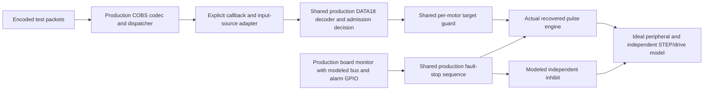

# R14 production safety composition

Implemented 29 October 2026 on baseline `e422e3c` (PR #36), shared core `118e6b0965cee674994bd66d7b9fb7f07c7420e8`. Twenty host scenarios join production COBS/board monitoring, shared application safety decisions, and the unchanged recovered pulse engine. **Normal R14 motion remains locked.** The [simulation plan](../../FIRMWARE_SIMULATION_PLAN.md), [desktop/runtime lane](../r14-runtime/README.md) and [independent plant lane](../r14-step-plant/README.md) describe the wider coverage and remaining work.

## What now runs together

The new executable compiles actual `CobsTransport.cpp`, `R14Hardware.cpp`, `BoardIo`, `MotionAdmission<false>`, the drive alarm latch and `SharedMcpwmStepEngine.h`. It reuses the earlier deterministic board and independent pin/plant models. Production `main.cpp` now calls two small shared headers: [ControllerMotionPayload.h](../../../controller/include/ControllerMotionPayload.h) preserves DATA18 decoding and the per-motor write guard; [R14RuntimeSafety.h](../../../controller/include/R14RuntimeSafety.h) preserves the admission decision and alarm/reconnect stop sequence. GPIO47/48, pause, bench-stop and StepDriver operations remain bound in `main.cpp`. Source contracts check those bindings and the locked build/boot policy.



This is **production-seam composition**, not the complete `main.cpp` task graph or a CPU emulator. The ingress callback/input selection is a declared test adapter; it is not the persisted source-selection/NVS path. The normal production staging gate blocks before IK. A fallback shared-core mapping/IK path in the adapter exists to expose a bypass, but these locked cases do not qualify that full motion pipeline. The desktop application/handshake still runs in its separate loopback lane.

The board monitor advances its existing tick clock; the pulse model advances its own cycle clock at explicit scenario boundaries. Their event ordering is controlled, but they do not share a target scheduler. **No stop latency, dual-core race, GPIO propagation or physical gate timing is measured.** Board input and engine SDK headers remain private to their test targets; the board GPIO configuration type/function are renamed only within that host library to prevent collisions with the pulse model.

## Scenarios and observations

All twenty scenarios pass locally under MSVC. Controller CTest contains 60 entries: the 85-case unit executable, ten board-runtime scenarios, 29 plant scenarios and these twenty composed scenarios. Linux/Windows CI runs the same entries and four additional composition negative controls. See the [curated local receipt](2026-10-29/results.json) for every scenario and source hash.

| Group | Cases | Observable result |
| --- | ---: | --- |
| Locked serial/Ethernet | 2 | Valid fixed-vector payload and 64 sequenced frames reach decoding; zero guarded target writes or STEP edges even after the test clears software pause; inactive-source adapter drops its packet |
| Protocol | 1 | All sub-18-byte DATA18 frames are rejected; null/short payload decode is refused; wrap, duplicate and reordered sequence bookkeeping matches current policy; every delivered frame remains blocked |
| Local diagnostics | 1 | Remote field request refused; local field on/off and status round trip work; ARM/HOME remain rejected and no torque-arm edge occurs |
| Fault before backend initialization | 2 | Alarm or initial bus failure invalidates admission and asserts modeled inhibit without calling an uninitialized backend; later initialization does not revive motion |
| Alarm with healthy bus | 6 | Each alarm identity latches; admission invalidation and pause precede inhibit, stop and target discard |
| Alarm while I²C fails | 6 | Each direct GPIO alarm remains observable independently of the failed bus; both callbacks run; recovery does not clear permission or repeat the one-shot reports |
| Reconnect and bus recovery | 2 | Stop/discard executes; queued/fresh frames and a later local field-feed request cannot restart outputs |

The fourteen alarm/reconnect/bus containment cases deliberately **start and preload the backend directly in the test**, bypassing production boot solely to make a missing stop observable. Traces mark `containment_test_override=true`. This is fault injection into an otherwise unreachable staging state, not a production arm command. The modeled inhibit blocks subsequent physical travel while pending pin pulses drain. Residual pin edges during drain are recorded; zero post-fault pin edges are not asserted. The other six cases never start the backend and record zero edges.

The sequence protocol currently **counts disorder and delivers frames**, including duplicates/reordering. This work preserves that policy; it does not add anti-replay or a watchdog. The independent R14 motion lock rejects those frames. Field-good diagnostics and the INA226's driver-5-V reading do not establish remote sensor voltage or cable margin.

Representative evidence: [locked serial summary](2026-10-29/locked-serial.json), [its board trace](2026-10-29/locked-serial.board.json), [its pulse trace](2026-10-29/locked-serial.plant.json), [axis-5 alarm during bus failure](2026-10-29/bus-alarm-5.json), [its board trace](2026-10-29/bus-alarm-5.board.json), [its pulse trace](2026-10-29/bus-alarm-5.plant.json), and [fault before initialization](2026-10-29/startup-alarm.json). Full per-case traces are generated in the build directory and uploaded by CI.

## Detection and reproduction

Four isolated source-copy defects must fail their specific scenario: bypass admission, bypass the motor guard, omit backend stop, or remove the wire mask. The first two expose an actual guarded target write to the engine; the third exposes the missing stop call and the fourth breaks an independent byte vector. A crash or unrelated failure is insufficient. [Sensitivity receipt](2026-10-29/sensitivity.json). No production source is mutated by the helper.

```sh
git submodule update --init --recursive
cmake -S controller/tests -B build-controller -DCMAKE_BUILD_TYPE=Release
cmake --build build-controller --config Release
ctest --test-dir build-controller -C Release --output-on-failure --no-tests=error
python tools/check_r14_composition_sensitivity.py --output /absolute/temporary/composition-mutants
python controller/tests/test_estop_source_contract.py
python controller/tests/test_r14_failclosed_source_contract.py
```

Each scenario has a fresh process and a CTest timeout; monitor scheduling also has a bounded host wait. No serial port, device discovery, LAN endpoint, flashing or real motor is involved. The recovered engine, staging admission class, ESP-IDF options and frozen PCB exports are unchanged. The application seam extraction intends to preserve existing firmware behavior; full-size and Mini CI builds check both bindings.

Remaining work includes connecting the real desktop lane to these safety seams, exercising the complete application/task/NVS graph, a unified scheduler for logical deadline tests, and a supported target-image protocol path past QEMU's W5500 limitation. Physical pulse/gate, sensor power, wiring and mechanics qualification still follows [R14 bring-up](../../../hardware/pcb/6dof2_r14/BRINGUP.md).
