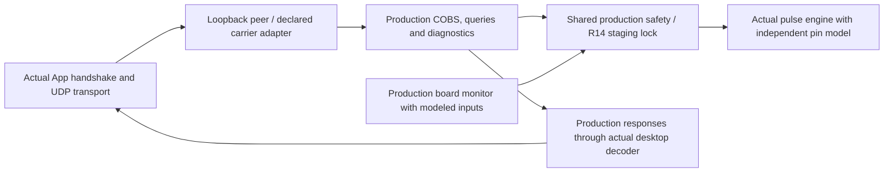

# Desktop transport through R14 safety

Implemented 29 October 2026 on baseline `b0abaf7` (PR #37), shared core `118e6b0965cee674994bd66d7b9fb7f07c7420e8`. Ten Windows scenarios connect the actual desktop network transport and application handshake to the [combined board/safety/engine runner](../r14-composition/README.md). This closes the separate-transport-lane gap in the [simulation plan](../../FIRMWARE_SIMULATION_PLAN.md); full application/task execution remains outside this test.

## Execution and boundaries

The executable links production `UdpTransport`, `App::beginNetworkHil`, response parsing and handshake polling, firmware COBS/diagnostic/query handlers, the actual R14 board-monitor task, shared admission/stop helpers, `MotionAdmission<false>` and the unchanged pulse engine. It uses the earlier board and independent pulse models through a [test-only facade](../../../controller/tests/integration/composed_fixture.h). No production source changes are required for this delivery.



Every endpoint binds exclusively to `127.0.0.1` on an OS-assigned port. The direct peer substitutes W5500 delivery and uses its Ethernet source tag. The bridge peer substitutes byte relay into the fragmented console decoder; it is **not the actual Voron bridge** and does not qualify its LIVE/control policy. Device identity/default geometry, SDK calls, I²C devices, GPIO and scheduling remain declared substitutes. Board ticks and pulse cycles advance separately, so there is no stop-latency or dual-core timing assertion.

`App`/plugin lifetime shells avoid GUI/settings/plugin initialization. The real full `App::update`, TX worker, settings/NVS persistence and production `main.cpp` task graph are not linked. Tests deliberately call the real transport API directly, including adversarial traffic outside App readiness; this does not claim the normal UI/worker emitted those frames. The ingress/source-selection callback is still the explicit composition adapter. No backend is started, preloaded or armed in this lane. The test clears only the software E-stop pause to demonstrate the independent R14 staging lock; every case records **zero target writes, zero STEP edges and no torque-arm edge**.

## Cases and observed contracts

All ten cases pass locally under MSVC Release, along with all 22 app CTest entries and all 60 controller CTest entries. The [local receipt](2026-10-29/results.json) retains every case and source hash. CI runs the desktop lane on Windows because the production transport uses Winsock; Linux continues to run the controller lanes.

| Cases | Count | Checked result |
| --- | ---: | --- |
| Direct/bridge locked | 2 | Independent fixed motion vector survives real packing, sockets and firmware decoding; every decoded request is rejected |
| Direct/bridge alarm | 2 | Axis-4 alarm reaches shared stop/discard; clearing the input and sending more frames cannot clear the latch or enable motion |
| Direct/bridge bus recovery | 2 | Failed I²C reaches the shared stop callback once; recovered bus and fresh motion remain locked |
| Direct/bridge reconnect | 2 | App loses readiness and clears a queued command; direct mode negotiates again, bridge retains its distinct contract; carrier-held old datagram and new traffic both remain blocked |
| Alarm during direct handshake | 1 | Alarm is injected while the App waits for identity; subsequent successful negotiation grants transport readiness only |
| Bridge TCP loss with UDP alive | 1 | Actual control-reader observes closure; App readiness/command queue clear while UDP stays open; adversarial UDP traffic and later reconnect remain locked |

Direct mode performs FINGERPRINT/CONFIG/BITS negotiation and confirms 18-bit input. Bridge mode preserves the existing bypass: a connected control socket makes the App ready and selects **raw channel 0x07**. The actual full-size R14 COBS dispatcher does not implement that channel; two real raw frames per bridge case are ignored before its motion callback. Baked DATA18 frames sent explicitly through the bridge transport API do reach decoding and are rejected by the staging lock. The tests do not relabel those baked frames as the bridge's normal raw worker output or add raw support to R14.

R14 diagnostics remain local-console only: direct Ethernet requests are denied, while the test bridge's serial-source adapter can toggle the modeled field feed and receive actual status/ARM-rejection replies. This source behavior does not qualify real remote bridge authority. Feed status does not measure remote sensor voltage or prove power margin.

UDP is connectionless. Closing/recreating the desktop transport is not a demonstrated firmware disconnect/watchdog path, and the test does not synthesize one: controller I/O-fault callbacks remain zero in reconnect-only cases. Safety there comes from the unchanged independent R14 lock. A carrier-held old packet is explicitly delayed/replayed by the test peer; no anti-replay policy is invented.

Representative traces: [direct locked](2026-10-29/direct-locked.json), [bridge control loss](2026-10-29/bridge-control-loss.json), [handshake-time alarm](2026-10-29/handshake-fault.json), [its controller summary](2026-10-29/handshake-fault.controller.json), [board events](2026-10-29/handshake-fault.board.json) and [pulse model](2026-10-29/handshake-fault.plant.json). CI uploads all case summaries and nested traces.

## Detection and reproduction

Three isolated production-source defects must fail specific integrated assertions: reverse the desktop wire axes, drop the actual board alarm dispatch, or retain App readiness on disconnect. [Sensitivity receipt](2026-10-29/sensitivity.json). The helper compiles temporary source copies; a crash or unrelated failure does not count. Production files remain unchanged.

```sh
git submodule update --init --recursive
cmake -S app -B build-app
cmake --build build-app --config Release
ctest --test-dir build-app -C Release --output-on-failure --no-tests=error
python tools/check_desktop_safety_sensitivity.py --app-build build-app --output C:/temp/desktop-safety-mutants
```

If the app was configured with a separate pinned cJSON source directory, pass that same path with `--cjson-source`. Each scenario runs in a fresh process with bounded socket, handshake and CTest waits. No device discovery, live bridge connection, serial access, flashing or physical hardware is involved.

Next coverage should exercise the actual application TX/command-queue worker and full controller task/NVS graph, then a supported target-image protocol route past the documented QEMU W5500 gap. Physical qualification remains governed by [R14 bring-up](../../../hardware/pcb/6dof2_r14/BRINGUP.md). The recovered R13 engine, staging admission, ESP-IDF build options and frozen PCB exports are preserved.
