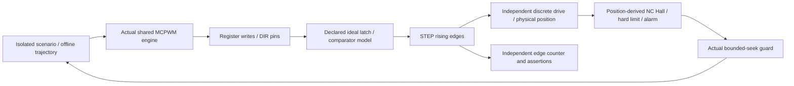

# Independent step-driven plant integration

Implemented 28 October 2026, following the [simulation plan](../../FIRMWARE_SIMULATION_PLAN.md) and [protocol/runtime work](../r14-runtime/README.md). This adds 29 host scenarios. Production firmware, the recovered R13 engine, R14 admission lock, SDK options and PCB exports are unchanged.

## Method and assumptions

The executable includes **unchanged `SharedMcpwmStepEngine.h`**: actual ISR, direction guard, register writes, latch accounting and stop/resume. A separate [peripheral/plant model](../../../controller/tests/plant/plant_model.cpp) supplies the narrow SDK surface and advances latch/comparator events from those register writes. It never reads the engine's position/target to generate travel. Signed pin-edge counts are compared with engine bookkeeping after the pipeline drains.



The drive accepts one count per received rising edge. Stall, dropped travel and reversed drive wiring can diverge from requested targets and engine counts. Hall inputs come from physical position, except explicit stuck-input faults. A physical hard limit asserts a modeled alarm. The test's independent inhibit blocks drive travel while software drains issued pulses; this is an environment adapter, not proof of PCB gate circuitry or `main.cpp` stop wiring.

| Surface | Declared test contract | Qualification limit |
| --- | --- | --- |
| Timer/CPU | 240 cycles/us, 960-cycle periods, deterministic 16-cycle clock reads | Not instruction-accurate Xtensa, ISR latency, FreeRTOS or dual-core scheduling |
| Shadow force | Ideal latch at phase 955 after modeled TEP | Selected contract consistent with the engine default; does not independently establish real latch phase |
| Compare output | Rise/fall 1/3 us after modeled latch; 2 us high | No electrical pad, receiver, EMI or analog timing evidence |
| DIR | Fixed nominal polarity, both GPIO banks, at least 8 us after a changed DIR | Ordering under this model, not real setup/hold |
| Drive | Discrete count per accepted edge; independent faults | No inertia, backlash, gear calibration, encoder electronics or load |
| Seek inputs | Position-derived NC Hall; assumed bottom/calibration validity | Not qualified IO mapping, homing or measured startup sector |

Unsupported period, latch mode, GPIO and register bits fail the model. Allocation succeeds for its declared configuration; allocation-failure recovery is not tested. SDK substitutes are private to the host test target.

## Coverage and results

All 29 cases pass locally under MSVC. Controller CTest now has 40 entries: the existing 85-case unit executable, ten board-runtime scenarios and 29 plant scenarios. Linux/Windows CI runs them and retains all JSON traces.

| Group | Observable assertions |
| --- | --- |
| Signed vectors / clock wrap | `[12,-24,36,-48,60,-72]` and return to zero; exact signed/unsigned edges and physical travel; repeat across 32-bit cycle-counter wrap |
| Offline trajectory | Actual schedule drives actual engine; fixed independent quarter-point vectors and final physical positions. Sampled targets can produce fast pulse bursts: this does not qualify physical speed/acceleration/jerk or production execution |
| Staging lock | `MotionAdmission<false>` refuses configuration/arm/home; test adapter never starts the timer; zero STEP |
| Limits | Invalid engine targets emit nothing; independent physical hard limit asserts alarm and faults seek |
| Stop/resume | Actual drain, discarded targets and three-period resume guard; eight asynchronous fault offsets and modeled inhibit |
| Interrupts | Masked gap exercises latch correction and independent count agreement. Permanently masked ISR latches `stopTimingFault`, stops/forces output low and refuses resume; software position is then not trusted as physical travel |
| Bounded seek | Six position-derived Hall edges; capture still does not establish home or allow normal motion |
| Drive / Hall faults | Stall, lost travel, reversed drive; stuck closed/open at boot, early/late edge, deadline edge and wrong requested direction. Missing physical travel is bounded by pulse/time limits, not claimed as immediate encoder detection |
| Safety inputs | E-stop/field loss, stale sample and each of six alarm identities; fault stays latched without automatic re-arm |

Representative axis-0 values from the [complete local receipt](2026-10-28/results.json):

| Case | Engine count | Pin count | Physical travel | Outcome |
| --- | ---: | ---: | ---: | --- |
| Healthy seek | 6 | 6 | 6 | All edges captured; normal motion blocked |
| Stall | 20 | 20 | 0 | Seek pulse limit |
| Every second travel step lost | 20 | 20 | 10 | Seek pulse limit |
| Reversed drive wiring | 20 | 20 | -20 | Seek pulse limit |
| Locked staging component | 0 | 0 | 0 | Timer never started |

Three deliberate defects are compiled in isolated engine copies: skip DIR guard, ignore quiescence permission, or disable latch compensation. Their scenarios must fail with the specific independent-count/drain assertion; [sensitivity receipt](2026-10-28/sensitivity.json). Production source remains read-only. Representative full traces: [vectors](2026-10-28/vectors.json), [stall](2026-10-28/stall.json), [interrupt gap](2026-10-28/irq-gap.json). The local receipt records source hashes and all case summaries without duplicating every raw trace.

## Reproduce and remaining boundary

Initialize the shared-core submodule, then:

```sh
cmake -S controller/tests -B build-controller -DCMAKE_BUILD_TYPE=Release
cmake --build build-controller --config Release
ctest --test-dir build-controller -C Release --output-on-failure --no-tests=error
python tools/check_step_plant_sensitivity.py --output /absolute/temporary/plant-mutants
```

Each case uses a fresh process, without singleton/reset hooks in production. Traces identify the isolated lane and hardware timing as unqualified. A negative control must produce the intended failure text, not merely crash.

Positive motion is authorized only by the **test composition**. This runner does not link production `main.cpp`, App/transport, board monitor or physical hardware; those have separate test lanes. Production staging admission and the seek guard's normal-motion permission remain closed. Joining the lanes into a full command/task/output runtime, validating wider peripheral timing, closing QEMU's W5500/console gap and physical HIL remain separate work. No production homing, six-axis motion or hardware gate is enabled or qualified. Physical checks still follow [R14 bring-up](../../../hardware/pcb/6dof2_r14/BRINGUP.md).
