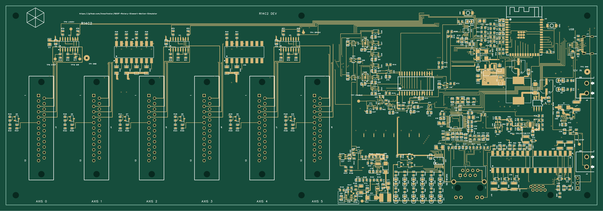

# Hardware

[Repository](../README.md) ? [Controller](../controller/README.md) ? [App](../app/README.md) ? [Documentation](../docs/README.md)

**R14C2 ordered, 2 November 2026; awaiting physical testing.** The original R14 was ordered on 26 October and later required the J12 clearance correction. C2 preserves that correction and changes three supplier-code groups. R13 was demonstrated on one bench axis; that evidence does not qualify the new R14 circuits or a loaded platform.

| Start here | Contents |
| --- | --- |
| [R14 status](pcb/6dof2_r14/README.md) | Ordered snapshot, PCB/schematic previews, BOM and acceptance plan |
| [Design philosophy](pcb/6dof2_r14/DESIGN_PHILOSOPHY.md) | Pulse permission, retained healthy-axis torque, sensing and hardware checks |
| [Firmware evidence](pcb/6dof2_r14/FIRMWARE_STATUS.md) | Recovered R13 baseline, new R14 code and qualification limits |
| [Design review](pcb/6dof2_r14/review/README.md) | Section report and component/pin/copper/label registers |
| [Bench qualification](pcb/6dof2_r14/BRINGUP.md) | Electrical, cable, pulse, fault and drive tests |
| [C2 ordered exports](pcb/6dof2_r14/exports/2026-11-02-ordered/README.md) | Frozen Gerber/BOM/CPL, master, STEP, PDFs and hashes; physical testing pending |
| [Mechanical models](mechanical/) | Platform and mini printed-part assets |
| [Platform geometry](mechanical/platform_geometry.md) | Dimensions, motor layout and calibration |

Gerber, assembly BOM and placement CPL are separate JLC inputs. A portable EasyEDA archive or STEP ZIP is not the fabrication upload. Use one matching release package; never mix historical exports or carry an old JLC preview into a corrected order.

[R13](pcb/6dof2_r13/README.md), its frozen [RC4 package](pcb/6dof2_r13/r13-rc4-2026-09-23/README.md), [R12](pcb/6dof2_r12/) and [legacy experiments](pcb/legacy/README.md) remain history. The older [board overview](pcb/6DOF2_BOARD.md) and [firmware backlog](pcb/6DOF2_FIRMWARE_TODO.md) retain dated context and link to the current R14 authority. Frozen package internals and hashes are preserved.
