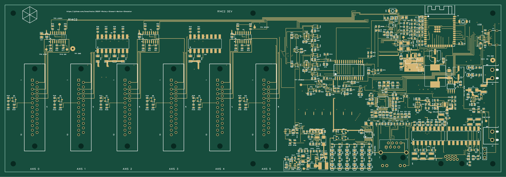
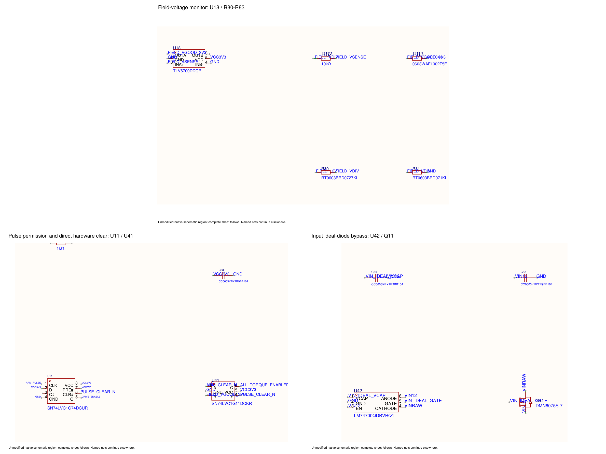

# R14 six-axis controller

**R14C2 ordered on 2 November 2026; awaiting physical testing.** The saved master contains better-stock resistors, six Amphenol DB25 sockets and a Hanrun Ethernet jack. Fresh exports reproduce the reviewed C2 source, CAM and assembly tables. The [ordered snapshot report](review/2026-11-02-ordered/README.md) records checks and acceptance limits. Order placement is confirmed in the conversation; factory-upload bytes and allocation were not independently captured.

The ESP32-S3 controller provides Ethernet, six differential STEP/DIR outputs, independent servo-on latches, protected 12 V Hall-sensor power and direct hardware pulse inhibition. C2 preserves the R14C1 J12 clearance correction, the corrected 11.046 V nominal falling sensor-monitor threshold, Q11 **DMN6075S-7 / C155242**, every firmware interface and the recovered R13 pulse engine. Normal motion admission remains locked pending physical qualification.

[Design decisions](DECISIONS.md) · [Design philosophy](DESIGN_PHILOSOPHY.md) · [Review method](REVIEW_METHOD.md) · [Firmware evidence](FIRMWARE_STATUS.md) · [Bring-up](BRINGUP.md) · [C2 order record](ORDER_RECORD_C2.json) · [Original order record](ORDER_RECORD.json)

## PCB and schematic

[PCB drawing: four copper layers (PDF)](exports/2026-11-02-ordered/R14-PCB.pdf) · [Top-layer SVG](drawings/R14C2-PCB-top.svg) · [Editable PCB and schematic](exports/2026-11-02-ordered/R14-project.epro2)

The drawing renders actual C2 Gerbers, including drills, slots and ink. Both native documents contain all 324 production components and 1,214 logical pins. The source has been saved, closed, reopened and freshly exported; temporary staging parts are absent.

[Schematic PDF: details and full sheet](exports/2026-11-02-ordered/R14-schematic.pdf) · [Fresh native full-sheet SVG](exports/2026-11-02-ordered/R14-schematic.svg) · [Schematic netlist](exports/2026-11-02-ordered/R14-schematic.net)

The crops retain native label placement and named-net stubs. Use the vector full sheet and netlist for continuations; the inherited compact blocks contain overlapping labels. C2 changes connector sourcing and J10 pin roles; the monitor, hardware clear and input bypass circuits are unchanged.

## Frozen C2 ordered snapshot

| File | Purpose |
| --- | --- |
| [Gerber/drill ZIP](exports/2026-11-02-ordered/R14-Gerber-FS36.zip) | Four-layer fabrication geometry, 300 × 101.6 mm, metric 3.6 format |
| [Assembly BOM](exports/2026-11-02-ordered/R14-BOM-JLC.csv) | All 324 required fitted parts grouped into 91 supplier codes |
| [Placement CPL](exports/2026-11-02-ordered/R14-CPL-JLC.csv) | Native Mid coordinates/rotations; matching reference set |
| [EasyEDA project](exports/2026-11-02-ordered/R14-project.epro2) | Saved/reopened master snapshot, PCB and schematic |
| [Assembly STEP](exports/2026-11-02-ordered/R14-assembly.step.zip) | All 324 named component shapes checked; model limits disclosed |
| [Export guide and manifest](exports/2026-11-02-ordered/README.md) | File roles, SHA-256 hashes and outstanding physical tests |

R75/R143 use **C22766**, J3–J8 use **C3110947 / L77SDB25SOL2**, and J10 uses **C12074 / HR911105A**. The [public inventory screen](review/2026-11-01-stock/inventory/INVENTORY.csv) records five-board net fitted demand across all 91 codes; private allocation, attrition and through-hole assembly handling remain unverified. Amphenol signal contacts are rated 3 A. Its required 1.10 mm signal drills and the Hanrun A/6 grid are persisted in the master.

Gerber ZIP, BOM and CPL are separate JLC PCBA inputs. The frozen set records the unchanged C2 master after order confirmation; it is not a downloaded factory receipt. Ethernet stack-up/impedance and entry-void/layer-transition exceptions, external mounting/hood/panel fit and inherited reduced mask gaps remain [acceptance limits](review/2026-11-02-ordered/README.md). The earlier candidate report preserves the technical concerns at the pre-order checkpoint; ordering does not close them.

## Review and qualification

The [C2 report](review/2026-11-01-stock/README.md) covers all 324 body outlines, 52,326 component pairs, 1,121 drilled features, 348 board-text envelopes, actual mask/paste/ink and four-layer copper. Fresh native DRC and schematic/PCB comparison are empty. Final measured planar MDI pair mismatch is below 0.001 mm; this does not establish electrical delay matching, 100-ohm impedance or SI/EMI qualification.

The recovered tested R13 laptop firmware remains integrated; retained physical evidence covers one axis. Firmware is unchanged by C2. `MotionAdmission<false>` stays locked. No R14 powered tests have run. Follow [BRINGUP.md](BRINGUP.md), including the actual 15 ft sensor cable, voltage/hysteresis measurements, independent reset/fault/clear and pulse captures, then unloaded axis tests.

## Revision history

The [R14C1 mechanical correction](MECHANICAL_CORRECTION.md) fixed the confirmed J12 collision without removing J12. Its [complete files](exports/2026-10-27-clearance/README.md) and [review](review/2026-10-27-clearance/README.md) remain archived unchanged. The [28 October Amphenol study](review/2026-10-28-amphenol/README.md) supplied six-position model evidence; C2 now applies the replacement with new drills and sourcing metadata, while retaining its height/hardware qualification limits.

The [original ordered package](exports/2026-10-26/README.md) and `r14-ordered-2026-10-26` tag are preserved. Its confirmed J12 collisions still prevent approving that original placement. Trial routing and API debugging files remain outside the curated repository.
