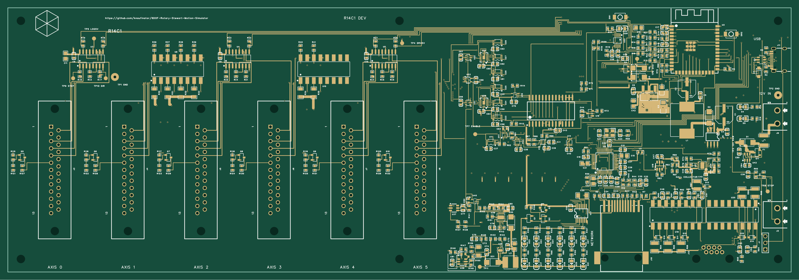
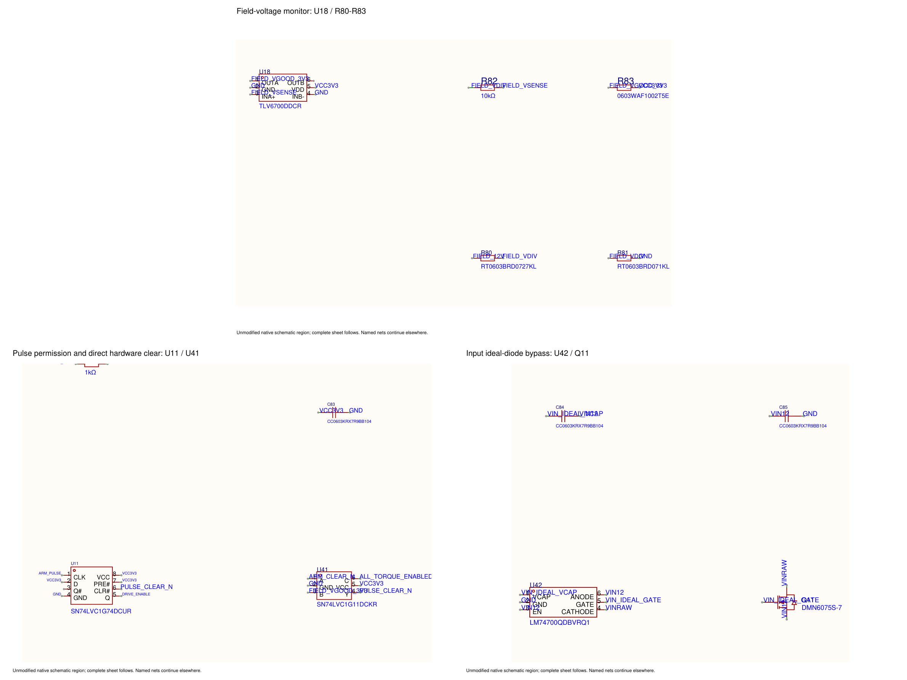
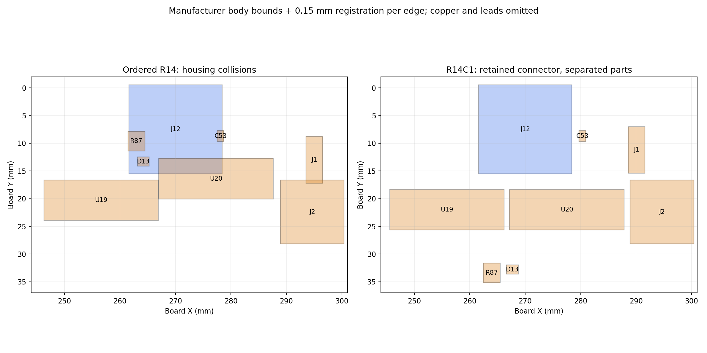

# R14 six-axis controller

**R14C1 clearance correction complete, 27 October 2026. Factory disposition and hardware testing pending.** J12 remains required and fitted. The original ordered placement has confirmed housing collisions and must not be approved for assembly. Read the [root cause and correction](MECHANICAL_CORRECTION.md) and [final review](review/2026-10-27-clearance/README.md).

The ESP32-S3 controller provides Ethernet, six differential STEP/DIR outputs, independent servo-on latches, protected 12 V Hall-sensor power and direct hardware pulse inhibition. The corrected voltage monitor and Q11 **DMN6075S-7 / C155242** remain unchanged. This correction changes physical placement, routing and labels; all 324 selected parts and electrical interfaces are retained.

[Design decisions](DECISIONS.md) · [Design philosophy](DESIGN_PHILOSOPHY.md) · [Review method](REVIEW_METHOD.md) · [Firmware status](FIRMWARE_STATUS.md) · [Bring-up](BRINGUP.md) · [Original order record](ORDER_RECORD.json)

The proposed all-black Amphenol DB25 replacement has a separate [six-position 3D verification](review/2026-10-28-amphenol/README.md): nominal internal clearance passes, but model/drawing height and mounting hardware remain unresolved. This study has not changed the master or the manufacturing files below.

## PCB and schematic

[PCB drawing, four copper layers (PDF)](drawings/R14C1-PCB.pdf) · [Top layer SVG](drawings/R14C1-PCB-top.svg) · [Editable PCB and schematic](exports/2026-10-27-clearance/R14-project.epro2)

The drawing renders the actual corrected Gerbers, including holes, slots and silkscreen. Inner and bottom copper are in the four-page PDF.

[Schematic PDF: detail pages and full sheet](drawings/R14-schematic.pdf) · [Fresh native schematic SVG](exports/2026-10-27-clearance/R14-schematic.svg)

The schematic circuit is unchanged; the existing readable PDF remains applicable. Use the native full sheet for named-net continuations.

[Corrected assembly STEP](exports/2026-10-27-clearance/R14-assembly.step.zip). All 324 component solids pass interference checks. The diagram above shows reviewed body bounds, not a 3D rendering; external plug, hood and enclosure fit still require qualification.

## Replacement manufacturing package

| File | Purpose |
| --- | --- |
| [Gerber/drill ZIP](exports/2026-10-27-clearance/R14-Gerber-FS36.zip) | Complete corrected four-layer fabrication geometry, 300 × 101.6 mm |
| [Assembly BOM](exports/2026-10-27-clearance/R14-BOM-JLC.csv) | All 324 fitted parts grouped into 91 supplier codes |
| [Placement CPL](exports/2026-10-27-clearance/R14-CPL-JLC.csv) | Corrected positions and matching reference set |
| [EasyEDA project](exports/2026-10-27-clearance/R14-project.epro2) | Saved/reopened master snapshot, PCB and schematic |
| [Manifest and export guide](exports/2026-10-27-clearance/README.md) | Hashes, file roles and manufacturing limits |

Use the complete replacement set. Factory acceptance has not been confirmed or submitted here. If the original PCB has already been fabricated, this correction requires new fabrication. [Original ordered files](exports/2026-10-26/README.md) and the `r14-ordered-2026-10-26` tag remain archived and unchanged.

## Review and physical qualification

The [final report](review/2026-10-27-clearance/README.md) covers every selected part's body dimensions, all mechanical pairs, all 2,684 copper objects, 1,098 drills and 348 board-level text envelopes plus twelve internal DB25 glyphs. Native electrical DRC and schematic/PCB comparison have zero findings. Actual Gerber geometry passes the recorded connectivity, drill, mask/paste and silkscreen checks. Documented inherited process/SI limits and unresolved external mechanical interfaces remain visible in the report.

The recovered tested R13 laptop firmware remains integrated; retained physical evidence covers one axis. Later R14 firmware changes compile and pass the previously recorded host checks, but normal motion admission stays locked pending physical R14 qualification. No R14 hardware tests have run. Follow [BRINGUP.md](BRINGUP.md), including the real 15 ft cable measurement, independent reset/fault and pulse captures, then unloaded single-axis and six-axis tests.

This directory publishes the master, readable drawings, manufacturing files and selected evidence. Intermediate route trials, duplicate exports and raw research remain outside the curated release.
