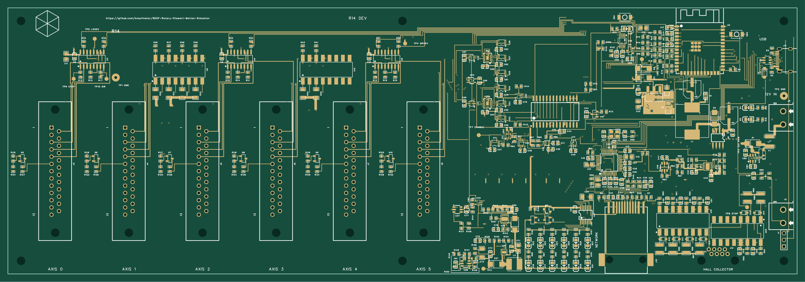

# R14 six-axis controller

**Ordered on 26 October 2026, confirmed by the owner. Hardware testing is next.**
This is the ESP32-S3 controller with Ethernet, six differential STEP/DIR outputs,
independent servo-on latches, protected Hall-sensor power and direct hardware
pulse inhibition. The ordered revision includes the corrected field-voltage
monitor and Q11 **DMN6075S-7 / C155242**. Y1 remains C9006.

[Design decisions](DECISIONS.md) · [Review method](REVIEW_METHOD.md) ·
[Firmware status](FIRMWARE_STATUS.md) · [Bring-up and acceptance](BRINGUP.md) ·
[Order record](ORDER_RECORD.json)

## Board and schematic

[PCB drawing, four copper layers (PDF)](drawings/R14-PCB.pdf) ·
[Top copper/silkscreen (SVG)](drawings/R14-PCB-top.svg) ·
[Editable PCB and schematic (EasyEDA Pro)](exports/2026-10-26/R14-project.epro2)

The PCB drawing comes from the frozen fabrication Gerbers. It shows actual
copper, holes, slots and silkscreen; the inner and bottom layers are in the PDF.

[Schematic PDF, detail pages plus the complete sheet](drawings/R14-schematic.pdf) ·
[Full native schematic SVG](exports/2026-10-26/R14-schematic.svg)

The detail pages are crops of the exported schematic, with named nets continuing
elsewhere. The full native single-sheet drawing retains the original workspace
layout. The [design philosophy](DESIGN_PHILOSOPHY.md) explains the signal paths.

[Assembly STEP](exports/2026-10-26/R14-assembly.step.zip). This is a CAD model;
physical connector, cable-hood and enclosure fit still require inspection.

## Ordered manufacturing files

| File | Purpose |
| --- | --- |
| [Gerber/drill ZIP](exports/2026-10-26/R14-Gerber-FS36.zip) | Four-layer PCB fabrication, approximately 300 × 101.6 mm |
| [Assembly BOM](exports/2026-10-26/R14-BOM-JLC.csv) | 324 fitted parts grouped into 91 exact supplier codes |
| [Placement CPL](exports/2026-10-26/R14-CPL-JLC.csv) | Matching references, positions, sides and rotations |
| [EasyEDA project](exports/2026-10-26/R14-project.epro2) | Authoritative editable PCB and schematic snapshot |
| [Release manifest](exports/2026-10-26/RELEASE_MANIFEST.json) | Artifact hashes, static checks and evidence limits |

The [export guide](exports/2026-10-26/README.md) distinguishes manufacturing
inputs from source/review files. Future electrical changes need a new revision
and export directory; do not overwrite this ordered baseline.

## What has been checked

The [section report](review/2026-10-26-10V/README.md) covers all 324 components,
1,214 logical pins, 2,667 copper objects and 360 labels. Native DRC and
schematic/PCB comparison have zero findings. Independent exported-CAM checks
cover real plane joins, shorts/opens, drills, mask/paste and silkscreen.
The [method and limitations](REVIEW_METHOD.md) explain exactly what those results prove.

The tested R13 laptop working tree was recovered and integrated. Its retained
physical evidence covers one axis. Later R14 stop/accounting and I/O changes
compile and pass host checks, but normal motion admission remains locked pending
R14 qualification. See [firmware provenance](FIRMWARE_STATUS.md).

## What happens when the boards arrive

Follow [BRINGUP.md](BRINGUP.md): inspect population and connectors; qualify input,
sensor and auxiliary power; measure the actual 15 ft cable; verify reset/fault
and pulse timing independently; then qualify one unloaded drive and all six axes.
Normal homing/motion remains unqualified. An order confirmation is not a hardware
test result. The owner reported the order; no order number or final factory
allocation/assembly-preview capture was supplied to this review.

## Repository organization

This directory contains the current design, decisions, readable drawings,
manufacturing files and selected review evidence. Repeated experimental exports,
solver trials, temporary scripts and downloaded website bundles are kept out of
the published package. The earlier 26-page review is retained only as a clearly
dated reference appendix; current counts and the order record take precedence.
