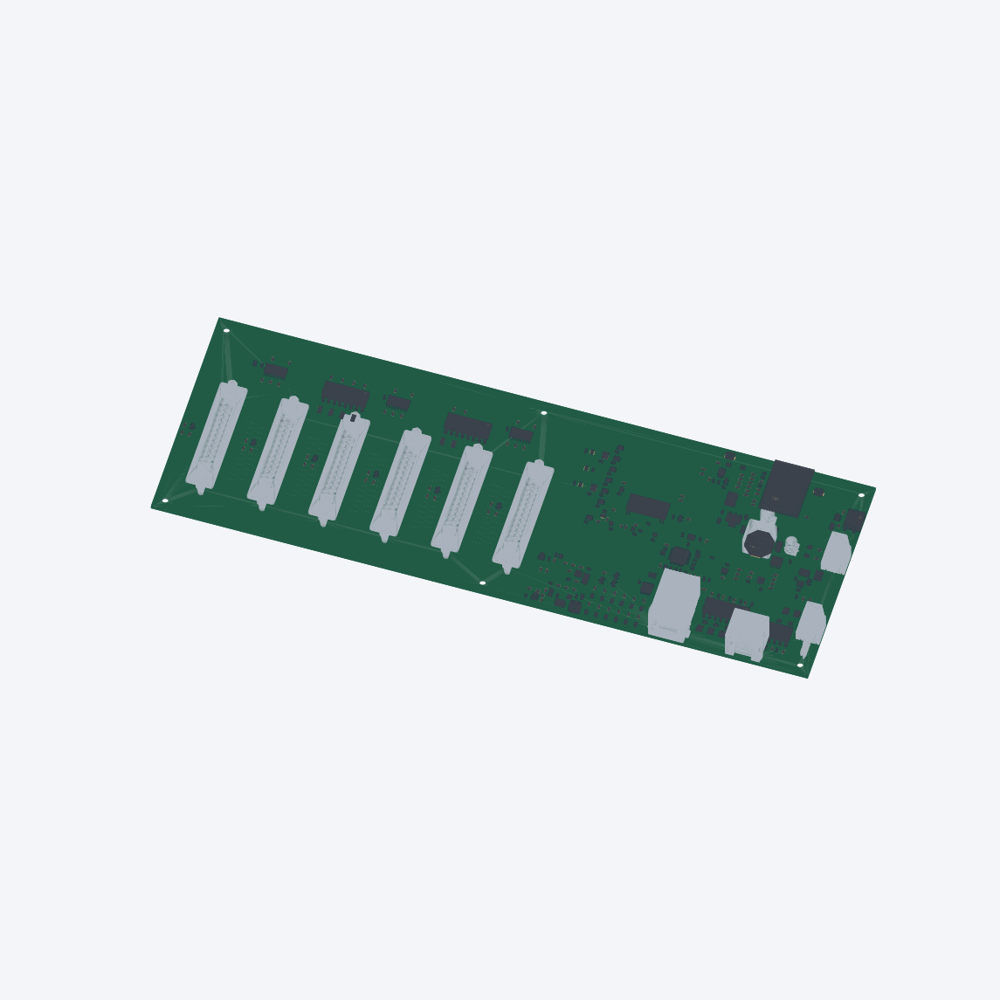
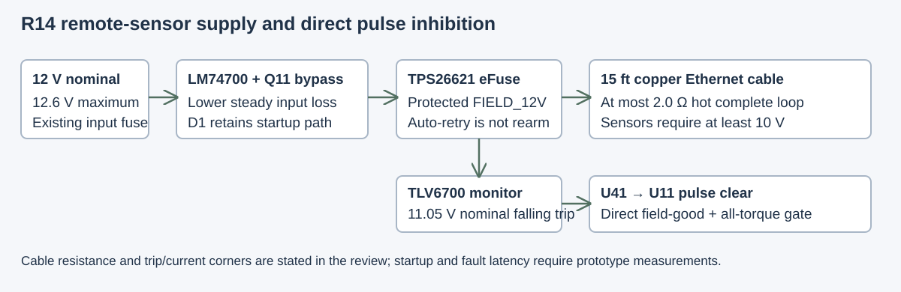
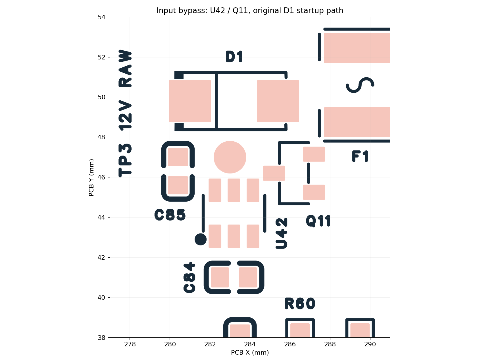
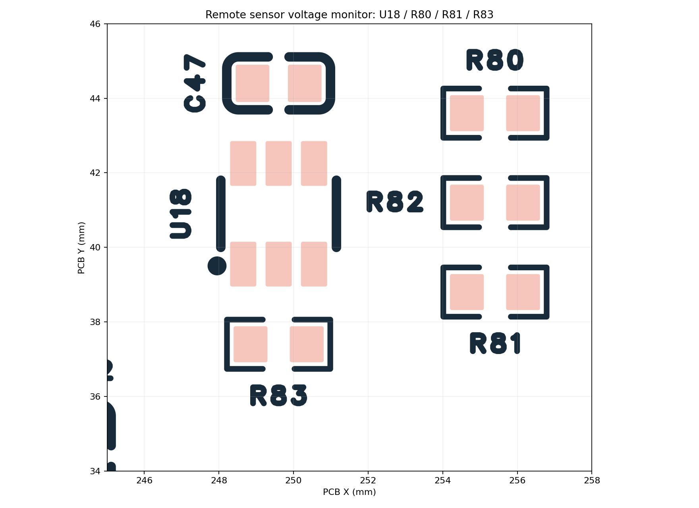
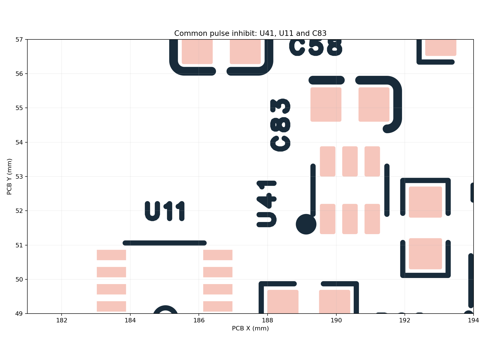

> **27 October correction:** the original placement has confirmed J12 housing interference. See [R14C1 correction](../../MECHANICAL_CORRECTION.md) and [current review](../../review/2026-10-27-clearance/README.md). Original ordered technical artifacts stay frozen; the earlier geometry review does not approve assembly.

# R14 corrected final design review — 2026-10-26

**Static circuit, source-coherence and manufacturing-geometry checks complete.**
The corrected EasyEDA master has **324 components, 1,214 logical pins, 2,667 copper
objects and 360 labels**. Native DRC and schematic/PCB comparison both return `[]`.
Use only the matching [2026-10-26 exports](../../exports/2026-10-26/README.md).
**The owner confirmed the order on 26 October 2026. Hardware testing is pending.**
The [order record](../../ORDER_RECORD.json) binds this revision. Final factory
allocation/placement/process evidence was not independently captured through the
review API; no manufactured R14 behavior is claimed by this report.

Current sourcing update: Q11 is **C155242 / DMN6075S-7**. The
[stock-correction addendum](Q11_STOCK_REFRESH.md) binds the unchanged geometry
review to the refreshed exports. The before-stock project/CAM hashes in older
geometry receipts remain evidence; the exact metadata/CAM parity proof connects
them to the new package. Y1 remains unchanged as instructed.

## Scope and evidence

Every current part is indexed by exact MPN, supplier code, pose, pin map, reference
basis and assembly disposition. All logical pins match between schematic and PCB.
Every trace/via/fill/test-pad object is attributed to actual exported copper;
every designator, board string and fixed DB25 digit is indexed. Geometry checks
cover the complete board, including the unchanged sections. Circuit references
and the [26-page baseline review](../R14-complete-design-review-2026-10-25.pdf)
provide the detailed pre-correction rationale. The current report supersedes its
missing-R13-source and old sensor-monitor findings; it retains its stated physical
qualification limits. Section counts below partition the parts for coverage and
include support parts assigned by net/proximity, not just the named ICs.

| Complete register | Coverage |
| --- | --- |
| [Every component](every-component.csv) | 324, exact supplier/footprint/pin/pose identity |
| [Every logical pin](every-pin.csv) | 1,214 source-to-PCB memberships |
| [Every copper object](every-trace-via-fill.csv) | 2,667; includes 1,757 native traces and 891 vias |
| [Every label](every-label.csv) | 324 designators, 24 board strings, 12 DB25 digits |
| [Firmware and DB25 contract](interface-contract.csv) | 78 exact mappings |
| [Coverage summary](COVERAGE.json) | Counts, no unmapped copper or label findings |

## Section-by-section findings

| Section / parts | Current review and firmware relationship | Qualification retained |
| --- | --- | --- |
| 12 V input / 5 V buck — 12 | J9/F1, XL1509, catch path, L1 and bypass connectivity agree with the reference and actual CAM. D1 remains at its original lands/polarity. | Nominal 12 V, max 12.6 V; fuse derating, full load, stability, inductor and temperature tests. No general 24 V rating. |
| Input ideal-diode bypass — 7 | U42 LM74700-Q1, Q11 DMN6075S, C84/C85 and retained D1 agree with the selected six-/three-pin maps. VCAP is referenced to VIN12, not GND; EN/anode on VIN12, cathode on VINRAW. | Measure startup, hot plug, shutdown, reverse/backfeed, surge and gate behavior. D1 remains the startup fallback. |
| Logic 5 V / 3.3 V — 7 | USB and buck feed LOGIC_5V through separate diodes; driver VCC5 remains distinct. LDL1117 and decoupling unchanged. | Output-above-input, retained charge, USB-only startup and thermal/load behavior. |
| MCU / boot / reset — 9 | Exact ESP32-S3-WROOM-1-N8R2 GPIO map matches motion, alarms, stop, arm/inhibit, SPI, I²C and native USB. N8 flash configuration retained. | Do not substitute an octal-memory module that consumes GPIO35–37. RF/enclosure and reset sequencing require hardware checks. |
| USB / recovery — 8 | USB-C duplicated contacts, CC pulldowns, protection and 33 Ω series legs agree. Python and native-S3 Windows host DTR policy corrected; docs mode is hardware-disabled. | Actual reconnect/traffic tests; J11 slots and shell paste require factory process review. |
| Ethernet / magnetics — 32 | W5500 and HR961160C integrated MagJack contact/center-tap/filter/termination contract retained; no extra external transformer. SPI35–39 and RC reset agree with code. | Eight inherited trace projections enter intentional reference voids, longest 5.37 mm; unchanged exactly. No full-channel impedance, SI/EMI or runtime qualification inferred. |
| Differential motion — 31 | Six STEP/DIR pairs, 33 Ω legs and AM26LS31 complement outputs agree at corrected DB25 pads. Existing R13 electrical map retained. | Physical edge/count/DIR guard, six simultaneous axes and loaded cable testing. |
| Common pulse permission — 25 | U11 latch plus new U41 AND gate implements arm-clear AND field-good AND all-torque. GPIO47/48 ownership retained. Hardware loss clears pulses independently of I²C. | Startup, power removal, latency and last-pulse measurements. Reset/recovery must require intentional rearm. |
| Drive alarm inputs — 14 | R30–R35 retain R13's 1.5 kΩ 1206 correction, replacing the overheated old 220 Ω 0603 concept. Healthy LOW/open HIGH agrees with retained R13 evidence and new independent MCU sampling. | All six installed-drive polarity/cable tests and fault-to-last-pulse timing. |
| I²C I/O / initialization — 4 | MCP23017 at 0x20, INA226 at 0x40; SDA41/SCL42. New adapter normalizes warm BANK state, writes inactive OLAT before directions, verifies outputs/readback. GPA7/GPB7 are output-only. | Actual stuck/missing bus, warm MCU reset and stale readback fault injection. |
| Protected Hall field supply — 15 | U17 TPS26621 auto-retry and 26.7 kΩ current setting retained. U18 now TLV6700, R80/R81 27 kΩ/1 kΩ precision, R82 retained, R83 pullup, D9 removed. Direct field-good reaches U41. | Cable/12 V current-limit/startup/fault/temperature envelope below; automatic retry cannot rearm motion. |
| Hall conditioning — 17 | J12 plain field 8P8C: 1 GND, 2 FIELD_12V, 3–8 Hall0–5. Six NC opto/filter channels reach GPA0–5. New adapter decodes six independent states. | Open at boot is not home; shorted/stuck signal, unplugged cable, magnet position and bounded seek require tests. |
| Hall indicators — 46 | AHCT14 and six red/green pairs, 1.5 kΩ LED resistors and reset-dependent blanking retained. They do not consume Hall I/O ports. | AHCT needs its valid 5 V range; color under rail collapse is not a home/safety verdict. |
| Six stored torque enables — 50 | Six independent latch Q/sink paths, individual alarm clear, global reset/release/AUX BAD and aggregate ALL_Q retained. U41 consumes the aggregate without forcing healthy torque requests off. | Logic Q is not real torque. Verify drive DI/SRV-ON polarity/parameters, reset/recovery and independent machine emergency stop. |
| Auxiliary boost / faults — 40 | TPS61170 nominal 16.4686 V, TLV6700 UV, TPS3700 OV and RTN-referenced eFuse/window logic match the prior reference review. C82 lands explicitly preserved; optional C78 remains absent. | UV minimum falling 12.69874 V versus max input 12.6 V leaves only 98.7 mV static separation. Startup, RTN, overvoltage, backfeed and transient behavior remain tests. |
| 5 V ADC / readback — 7 | INA226 VBUS/filter measures VCC5; both shunt pins are grounded. New adapter checks fresh bus conversions and DRIVE_ENABLE readback. | Cannot report load current or infer actual motor torque from this wiring. |

The DB25 logical contract is 3 STEP+, 14 STEP−, 4 DIR+, 5 DIR−, 6 SRV-ON,
9 AUX, 10 GND and 23 alarm on all six axes. The corrected physical numbering
and 1/13 artwork are retained. R13 crossover adapters are incompatible; real cable
and molded-contact continuity must be checked before drives are connected.

## Sensor correction and conditional voltage budget

The old nominal 9.522 V monitor admitted an undervoltage condition for sensors
requiring at least 10 V. The saved master now uses TLV6700 and a 27 kΩ / 1 kΩ
0.1%, 25 ppm/°C divider. U18 uses the existing TI DDC land geometry: 1.1 × 0.6 mm
lands, 2.7 mm row separation and 0.95 mm pitch. A catalog Device refresh that tried
to inherit smaller generic TSOT lands was overridden in the schematic; U37's
verified existing lands were also preserved. Generic 3D package height can be
conservative (1.5 mm model versus 1.1 mm DDC maximum); it is not a new fit certificate.

| Voltage budget | Value / scope |
| --- | --- |
| Nominal falling / rising trip | 11.046 V / 11.2 V |
| Calculated minimum falling trip | 10.752752 V |
| Calculated maximum rising trip | 11.399242 V |
| Confirmed cable length | 15 ft Ethernet; gauge/model unconfirmed |
| Required hot complete cable loop | ≤2.0 Ω including contacts; not yet measured |
| Additional board loop allowance | ≤0.4 Ω |
| Current screen used | 0.257935 A; derived from data specified at 24 V |
| Conditional steady remote floor | 10.133708 V |
| Supply contract | Nominal 12 V, maximum 12.6 V |

The [corner calculation](VOLTAGE_CONTRACT.json) includes divider tolerance/drift,
series resistance and input bias, reference range and hysteresis. Its remote floor
is conditional: TPS2662's cited current data do not establish a hard 12 V ceiling.
Actual cable/load/temperature/current-limit and dynamic shutdown tests are required.
Arbitrary slim or CCA Ethernet, low-input startup or externally forced negative
field voltage is not covered by that calculation.

## Persisted changes and native synchronization

New refs U41/U42/Q11/C83/C84/C85 are fitted; D9 is removed. U18/R80/R81/R83 are
replaced/reconfigured, R82 changes sense membership and U11 clear receives
PULSE_CLEAR_N. D1 is retained in its original pose. Placement comparison preserved
all 314 unrelated component states. Routing removed 26 obsolete traces/14 vias and
added 59 traces/27 vias. All six native pours were rebuilt, saved and reopened.
The saved route matches planned centerlines/widths/via dimensions within 0.000002 mm;
new-to-foreign actual copper clearance is at least 0.155902 mm against 0.1524 mm.

The final native mismatch was metadata, not an unexplained connectivity waiver:
explicit footprint inheritance, two identical capacitor Device aliases and five
Name expressions were reconciled. The two-value alias relink preserved all other
payloads ([proof](DEVICE_RELINK_PROOF.json)); the final native comparison and DRC
are empty ([receipt](NATIVE_VERIFICATION.json)). No broad native import was applied.
The API source and EPRO2 serializers differ in derived rules/local pad identifiers;
three archive-only zero-length copper stubs are exactly inherited from baseline
([delta supplement](DELTA_SUPPLEMENT.json)). Raw byte equality is not asserted.

## Whole-board geometry, labels and assembly

| Check | Final measured result |
| --- | --- |
| [Actual copper](ACTUAL_CAM_REVIEW.json) | 241 named physical nets / 1,080 named pads; zero missing pads, disconnected nets, shorts, NC contacts, unqualified floating copper, foreign/NPTH/edge findings |
| Actual ground reference | All 344 GND through-objects joined globally and directly to Inner1; no blanket software GND union |
| [Drills](DRILL_REVIEW.json) | 1,086 unique holes including four slots; 589,155 analytic pairs; min edge gap 0.302756582 mm against 0.302 mm gate |
| [Mask / paste](APERTURE_REVIEW.json) | All 891 via drills versus 1,062 SMT mask apertures and all paste; zero intersections |
| Inherited process review | 56 positive gaps below 0.125 mm review band; min mask gap 0.032061 mm. Band is not a factory acceptance rule; stencil/EP/registration acceptance remains required |
| New-via apertures | All 27; min mask gap 0.14679938 mm / paste gap 0.19693840 mm |
| [Signal reference](SIGNAL_REFERENCE_REVIEW.json) | Same trace inventory and unsupported lengths as baseline, max delta 0; eight intentional MDI-void exceptions retained |
| [Silk](SILK_REVIEW.json) | Zero actual ink overlap with mask; zero off-board ink; one closed outline |
| [STEP](../../exports/2026-10-26/STEP_VERIFICATION.json) | Valid OCCT shape, 1,620 solids, exactly 324 component references |

The via-only drill file duplicates 891 PTH operations; those are not additional
unique holes. No tenting, resin fill or capping is inferred from nullable native
fields. Exported drill-to-aperture geometry and factory registration/stencil
approval are distinct. Eleven required non-SMT/hybrid connector references remain
in BOM/CPL. Their assembly process, J11 shell slots/paste, J12 centroid, connector
hoods and mated cable/enclosure fit need the final factory/physical review.

All 12 changed designator witnesses and the [12 DB25 digits](DB25_DIGITS.png) were
visually read. TP1/2 GND; TP3 VINRAW; TP4 VCC5; TP5 LOGIC_5V; TP6 VCC3V3;
TP7 DRIVE_ENABLE; TP8 ESTOP_MCU; TP9 M0S_I; TP10 M0D_I; TP11 AUX15V_CTRL.
The historical R13 TP8-enable interpretation does not apply.

## R13 recovery and current firmware

The earlier report's missing tested pulse-engine finding is closed by recovery,
hash verification and integration of the laptop working tree. Ten exact recovered
files remain in [portable provenance](../r13-recovered-source/README.md).
Capture `DESKTOP-9LF81EF-20261025T2000` verified 352 hashes, source ZIP CRCs and three
Git bundles. Base is `7cc29d43fafb2de6d7da733621495c489b70ed64`, shared core clean at
`118e6b0965cee674994bd66d7b9fb7f07c7420e8`. Final binary SHA-256 is
`cc4f5eba9003e93ab9ab4efafaf1e90a2118d54fbf8b02334be1cddb343a6089`.

Only axis 0 was physically tested. Six final legs and a five-minute wave followed
the final cleanup/flash; earlier long soaks used a subsequently overwritten binary.
The final verified setup used Pn098=2, Pn102=1, Pn051=3000, 2,500 encoder counts,
50:1 gearbox and ±72° = 50,000 pulses. Generic shared-core scaling defaults remain
unchanged; the full application supplies the 2:1 drive override.

Later R14 changes add guarded scaling, quiescent stop/resume and period accounting,
expander/INA226 adapters, independent six-alarm polling, explicit seek requests,
native USB DTR policy and locked diagnostics. The new MCPWM/ISR stop path is **not**
physically covered by the R13 tests. Current checks passed: 85 host C++ tests,
10 bench-host Python tests, nine source-contract checks, separate R14/R13 ESP-IDF
builds, Windows Release/docs-safety builds and documentation transport guards.
Normal R14 motion admission remains locked (`motion_qualified=0`); diagnostics
cannot arm torque or implement a qualified normal homing/motion sequence.
See [firmware status](../../FIRMWARE_STATUS.md) and [bench plan](../../BRINGUP.md).

## Documentation verification

All 27 published READMEs were checked: 310 link/image occurrences and 44 unique
external URLs. No broken project-owned targets remain. The ST datasheet timed out
through local HTTP but the exact primary URL opened successfully through the web
reader as a 23-page PDF. Two managed `led_strip` vendor READMEs retain the same
upstream WorldSemi 404; generated dependency contents were not edited. The full
results are retained in `README_LINK_AUDIT.json`. Git whitespace checks passed.

## Exact remaining release and qualification gates

The CAD correction is finished and the owner subsequently confirmed the order.
The static review did not independently capture the final live JLC allocation,
every placement/polarity/rotation row or connector/stencil/via process acceptance.
These remain evidence limitations, not claims that the order is still waiting.
No desktop control was used.

After assembly, measure the cable resistance and remote supply, startup and fault
envelopes, physical pulse counts/last edge and DIR timing, alarm/torque/rearm
behavior, six-axis operation and bounded homing. These are prototype acceptance
activities, not evidence already obtained. No flash or motor command was performed
during this correction. Git publication records the ordered design and pending tests;
the order itself was reported by the owner.

## Primary reference basis

- [TI TLV6700](https://www.ti.com/lit/ds/symlink/tlv6700.pdf), [TPS2662](https://www.ti.com/lit/ds/symlink/tps2662.pdf), [LM74700-Q1](https://www.ti.com/lit/ds/symlink/lm74700-q1.pdf), [DMN6075S](https://www.diodes.com/datasheet/download/DMN6075S.pdf).
- [TI AM26LS31](https://www.ti.com/lit/ds/symlink/am26ls31.pdf), [SN74LVC1G74](https://www.ti.com/lit/ds/symlink/sn74lvc1g74.pdf), [SN74LVC1G11](https://www.ti.com/lit/ds/symlink/sn74lvc1g11.pdf), [INA226](https://www.ti.com/lit/ds/symlink/ina226.pdf).
- [Microchip MCP23017](https://ww1.microchip.com/downloads/aemDocuments/documents/APID/ProductDocuments/DataSheets/MCP23017-Data-Sheet-DS20001952.pdf), [WIZnet W5500](https://docs.wiznet.io/img/products/w5500/W5500_ds_v110e.pdf), [ST LDL1117](https://www.st.com/resource/en/datasheet/ldl1117.pdf).
- [Sensor selection](../../SENSOR_IO_SELECTION.md), [field contract](../../FIELD_INTERFACE_CONTRACT.md), [alarm resistor review](../../ALARM_INPUT_RESISTOR_REVIEW.md) and [baseline section review](../R14-complete-design-review-2026-10-25.pdf).

Large reproducibility intermediates remain at
`G:/My Drive/projects/6dof/pcb/reviews/2026-10-25-R14-repo-preparation/`.
The [package manifest](../../exports/2026-10-26/RELEASE_MANIFEST.json) binds the
portable release artifacts. Older dated failures remain history, not current DRC.
