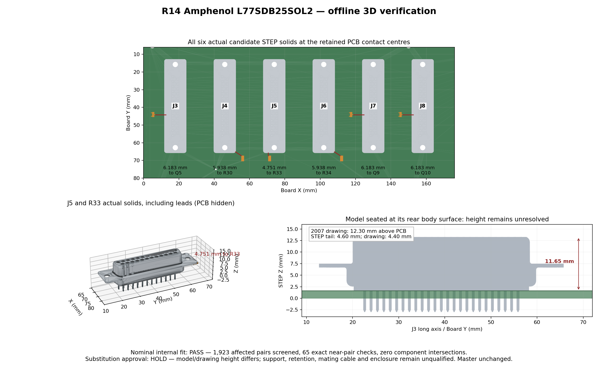

# Amphenol DB25 replacement: 3D verification, 28 October 2026

**Nominal internal clearance passes at all six positions. Substitution approval remains on hold because installed height and mounting hardware are not qualified.** This is an offline study of black Amphenol **L77SDB25SOL2 / C3110947** for J3–J8. The EasyEDA master and manufacturing package still contain the original Connfly connectors. No component, trace, drill, supplier identity or firmware was changed by this study.

## Measurements

The reviewed STEP model is [L77SDB25SOL2.stp](L77SDB25SOL2-user-supplied.stp). OCCT 8.0.1 reads it as **29 valid solids**, including the socket contacts, tails, insulator and shell. Its internal assembly name is `101-2524820010-A1_ASM`, dated 18 January 2019. The filename alone does not authenticate its origin or establish dimensional equivalence to the purchased part.

| Check | Result |
| --- | --- |
| Numbered contacts | All 25 centres agree with the native footprint within **0.000200 mm**; numbering follows the manufacturer's female mating-face drawing |
| Contact grid | 2.77 mm pitch, 2.84 mm row separation, 1.385 mm stagger |
| Mounting holes | Model: **47.04 mm** centres, **3.05 mm** diameter; native PCB centres differ by **0.000108 mm**, with approximately 3.20 mm nonplated holes |
| Body plan dimensions | Model **53.05 × 12.55 mm**; drawing nominal 53.04 × 12.55 mm |
| Six-position interference | **1,923 affected pairs** screened; **65 exact near-pair distance calculations**, zero intersections |
| Minimum nominal solid clearance | **4.751426 mm**, J5 to R33, including leads |
| Body height | **Unresolved:** model is **11.65 mm** above its rear seating surface; supplied 2007 drawing gives **12.30 mm** |
| Tail geometry | Model projects **4.60 mm** below that surface, drawing 4.40 mm; diameter 0.60 mm versus drawing 0.62 mm |

The candidate drawing's maximum XY dimensions, 53.24 × 12.75 mm using its stated ±0.20 mm tolerance, fit inside the previously reviewed 53.34 × 12.88 mm connector envelope. The [independent baseline body/access review](../2026-10-27-clearance/README.md) remains a conservative XY screen at these unchanged anchors. Exact STEP distances concern nominal geometry, not maximum-tolerance solid distances.

| Candidate | Closest retained component | Exact nominal gap |
| --- | --- | --- |
| J3 | Q5 | 6.182900 mm |
| J4 | R30 | 5.938107 mm |
| J5 | R33 | 4.751426 mm |
| J6 | R34 | 5.938168 mm |
| J7 | Q9 | 6.182685 mm |
| J8 | Q10 | 6.182631 mm |

## Registration and method

The baseline is the [R14C1 saved project](../../exports/2026-10-27-clearance/R14-project.epro2) and its [assembly STEP](../../exports/2026-10-27-clearance/R14-assembly.step.zip), containing 324 components. [MODEL_VERIFICATION.json](MODEL_VERIFICATION.json) records source/model/image hashes, every pin comparison, candidate transform, nearby pair and nearest-point witness.

A +90° rotation aligns the supplied model's contact grid with the native numbered footprint. An independent comparison against all 25 original exported tail axes gives 0.00008945 mm maximum residual. Candidate anchors retain X = 18, 46, 74, 102, 130 or 158 mm; Y = 39.25 mm. The assumed rear seating plane, model Z = −3.15 mm, is placed on the exported substrate top, Z = 1.618219456439 mm. No added spacer height is hidden in the transform.

For the six candidates versus the 318 retained components and each other, optimal analytic bounding boxes supply a distance lower bound. All pairs with a bound of 10 mm or less receive exact OCCT surface-distance calculations. Pairs beyond that band cannot collide. Intersection volume would be calculated for a zero-distance pair; none occurred. Rendered triangles illustrate the same solids and do not determine the measurements. Unchanged-to-unchanged checks remain in the baseline review.

The OCCT audit, inspection and rendering scripts remain in the local `2026-10-28-connector-substitutes` research folder. These scripts use local paths and are not presented as a portable repository command. This curated folder retains the model, reference drawing, numeric receipt and visual witness.

## Remaining qualification

1. **Reconcile installed height.** The [manufacturer drawing served by JLC](Amphenol-L77SDB25SOL2-drawing-2007.pdf), revision A dated 15 May 2007, shows 6.20 + 6.10 = 12.30 mm above the PCB. The supplied model measures 11.65 mm under the declared seating assumption. The [current manufacturer page](https://www.amphenol-cs.com/product/l77sdb25sol2.html) describes a 6.0 mm rear insulator/shell height; its current linked drawing could not be retrieved. These sources do not establish an agreed installed height. Do not stretch or shift the model to conceal the difference.
2. **Define support and retention.** This variant has flange clear holes and lacks integral standoffs, boardlocks and the original front screwlocks. Dimension the PCB supports and mating jackscrews to carry insertion and cable loads. Any added spacer changes installed height and requires another assembly check.
3. **Check the external interface.** Actual cable plugs/hoods, connector mounting STL, enclosure and tool-access volumes are not included. Bare connector clearance does not qualify these interfaces.
4. **Implement and release the source revision.** The drawing recommends **1.10 mm** signal holes, versus approximately **1.04 mm** currently. Earlier offline feasibility found room to enlarge all 150 holes, leaving at least 0.212 mm nominal copper annulus. This is still a planned change. Correct footprint/device/model associations in schematic and PCB, then save/reopen, rerun native DRC and schematic/PCB comparison, and regenerate/audit CAM, BOM, CPL, Gerbers and STEP.

This check establishes room for the proposed family on the board. It does not establish an order-ready substitution, a supported mating interface or tested R14 hardware. The production package is unchanged.

## Provenance

Model SHA-256: `dd893e762aeebee466735394db365e180566ce804e658f089b6f6450fbc37cbe`. The manufacturer PDF came from [JLC's file service](https://jlcpcb.com/api/file/downloadByFileSystemAccessId/8603144996329431040); its drawing identifier and date are visible on the sheet. The numeric receipt records both document hashes and the baseline assembly/source hashes. No supplier contact, factory submission, order or stock reservation was made.
